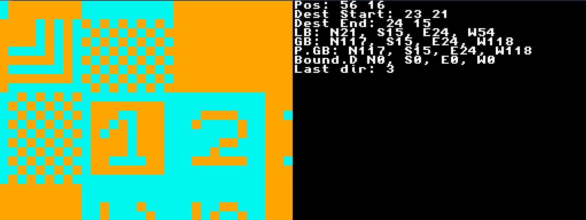
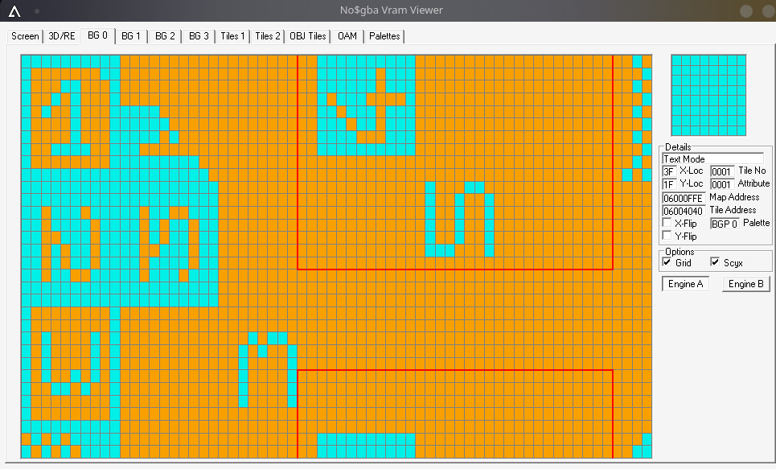

# A small Demo of dynamic Tilemap Streaming on the Nintendo DS

A small project demonstrating the feasibility of dynamically streaming background map data from Main RAM into VRAM while managing hardware scrolling adjustments. 

The primary objective is to bypass the NDS's hardware limitation for maximum background sizes by continuously rendering new chunks of a larger tilemap just outside the viewport before the Fixed pipeline GPU displays them.
